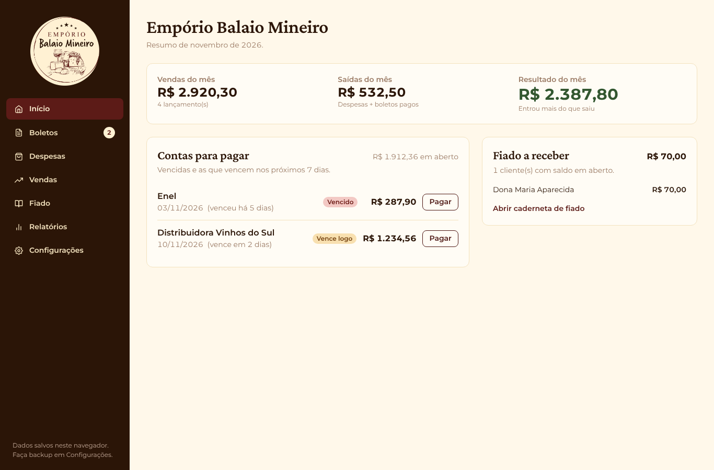

# Controle da Loja – Empório Balaio Mineiro

Sistema web para o dia a dia de um pequeno comércio: boletos a pagar, despesas, vendas, caderneta de fiado e relatório mensal. Visual baseado no Manual de Marca do Empório Balaio Mineiro.



## O que o sistema faz

**Boletos.** Cadastro preenchido sozinho pela linha digitável (digitada, colada ou lida por leitor USB), pelo PDF do boleto ou pela câmera do celular. Do código saem banco, valor e vencimento, com conferência dos dígitos verificadores. Funciona com boleto bancário e com contas de consumo (luz, água, telefone). Já considera a nova regra do fator de vencimento da FEBRABAN (reinício em 22/02/2025). Boletos vencidos e vencendo ficam destacados, e a linha digitável pode ser copiada para pagar no app do banco.

**Despesas.** Gastos pagos na hora, por categoria, com total do mês.

**Vendas.** Entradas no caixa por dia e por forma de pagamento (dinheiro, Pix, cartão).

**Fiado.** Caderneta por cliente com extrato de compras e pagamentos, saldo calculado automaticamente, pagamento parcial e lembrete pronto pelo WhatsApp.

**Relatórios.** Resultado do mês, gráfico dos últimos 6 meses, gastos por categoria, PDF para imprimir ou mandar ao contador e planilha Excel com tudo.

**Configurações.** Nome da loja, prazo de aviso dos boletos, backup e restauração dos dados.

## Como rodar

Precisa do Node.js 18 ou mais novo.

```bash
npm install
npm run dev
```

Abra o endereço que aparecer no terminal (normalmente http://localhost:5173).

Para gerar a versão de produção:

```bash
npm run build
```

A pasta `dist/` pode ser publicada de graça na Vercel ou na Netlify. A leitura pela câmera só funciona em endereço com `https` ou em `localhost`.

## Onde ficam os dados

Os dados ficam salvos no navegador (localStorage) do computador ou celular onde o sistema é usado, sem servidor e sem custo. Por isso é importante baixar um backup em **Configurações** com frequência e guardar o arquivo no Google Drive ou em um pen drive.

## Estrutura

```
src/
  contexts/LojaContext.jsx   dados da loja e gravação no navegador
  utils/boleto.js            leitura da linha digitável e do código de barras
  utils/pdfBoleto.js         importação do boleto em PDF
  utils/exportar.js          relatório em PDF e planilha Excel
  utils/formatters.js        moeda, datas e telefones no padrão brasileiro
  components/                menu, leitor de câmera e componentes comuns
  pages/                     uma tela por arquivo
```

## Tecnologias

React 18, Vite, Chakra UI, React Router, pdf.js, ZXing, jsPDF e SheetJS.

Projeto desenvolvido como atividade de extensão do curso de Ciência da Computação da UNIP.
